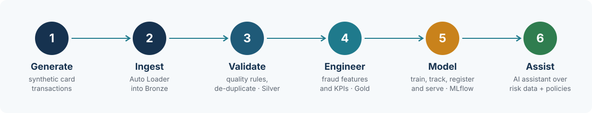

<p align="center">
  
</p>

<p align="center">
  
  
  
  
  
</p>

<p align="center">
  
  
  
  
</p>

<h3 align="center">End-to-end fraud detection on the Databricks Data Intelligence Platform</h3>

<p align="center">
  From raw card transactions to a governed, served fraud model and an AI assistant for analysts.<br>
  <sub>Built by <a href="https://www.linkedin.com/in/shridhar-c-14aa3b11"><b>Shridhar Ch</b></a> · banking risk &amp; fraud analytics → data &amp; AI engineering</sub>
</p>

<p align="center">
  <a href="#-business-problem"><b>Problem</b></a> ·
  <a href="#%EF%B8%8F-how-it-works"><b>How it works</b></a> ·
  <a href="#-architecture"><b>Architecture</b></a> ·
  <a href="#-whats-inside"><b>What's inside</b></a> ·
  <a href="#-quick-start"><b>Quick start</b></a> ·
  <a href="docs/RESULTS.md"><b>Results</b></a> ·
  <a href="#-roadmap"><b>Roadmap</b></a>
</p>

<br>

## 🎯 Business problem

> Card issuers lose money to fraud, and they lose good customers when genuine transactions are declined.
> Every decision must also stand up to auditors and regulators.

<table>
  <tr>
    <th width="33%">Catch more fraud</th>
    <th width="33%">Annoy fewer customers</th>
    <th width="33%">Stay audit-ready</th>
  </tr>
  <tr>
    <td align="center">Fraud caught per 1,000 alerts</td>
    <td align="center">False-positive rate</td>
    <td align="center">Every decision traceable to its data</td>
  </tr>
</table>

## ⚙️ How it works

<p align="center">
  
</p>

## 🏗 Architecture

<p align="center">
  
</p>

## 📦 What's inside

| | Stage | Implementation | Code |
| :-: | :--- | :--- | :--- |
| 🧪 | **Data** | Synthetic transactions with fraud bursts, a skewed "hot" merchant and injected bad records | [`synthetic_data.py`](src/fraud_lib/synthetic_data.py) |
| 📥 | **Ingestion** | Auto Loader into Bronze; Lakeflow Declarative Pipeline | [`fraud_pipeline.py`](src/pipeline/fraud_pipeline.py) |
| ✅ | **Quality** | Expectations drop bad amounts and missing cards; warn on currency | [`fraud_pipeline.py`](src/pipeline/fraud_pipeline.py) |
| 🔐 | **Governance** | Unity Catalog schemas, volume, card-ID column mask, lineage | [`00_setup`](notebooks/00_setup_catalog.sql) · [`02_mask`](notebooks/02_governance_column_mask.sql) |
| ⚡ | **Performance** | Reproduce data skew; fix with AQE and key salting | [`03_skew_demo`](notebooks/03_skew_demo.py) |
| 🤖 | **ML** | Gradient boosting · MLflow tracking · UC registry · `@champion` alias | [`04_train`](notebooks/04_train_fraud_model.py) |
| 🚀 | **Deployment** | Databricks Asset Bundle · GitHub Actions | [`databricks.yml`](databricks.yml) |
| 💬 | **AI assistant** | Vector Search over policy documents + Databricks App | *next milestone* |

## 🚀 Quick start

<details open>
<summary><b>Run on Databricks Free Edition</b></summary>
<br>

| Step | Action |
| :-: | :--- |
| 1 | Create a Databricks Free Edition workspace |
| 2 | **Workspace → Create → Git folder** → paste this repository URL |
| 3 | Run `notebooks/00_setup_catalog.sql` |
| 4 | Run `notebooks/01_generate_synthetic_data.py` |
| 5 | Create a pipeline from `src/pipeline/fraud_pipeline.py` (catalog `fraud`, schema `silver`) and start it |
| 6 | Run notebooks `02` → `03` → `04` |

</details>

<details>
<summary><b>Deploy with the Databricks CLI</b></summary>
<br>

```bash
databricks bundle validate -t dev
databricks bundle deploy   -t dev
databricks bundle run fraud_pipeline -t dev
```
</details>

<details>
<summary><b>Run the unit tests locally</b></summary>
<br>

```bash
pip install -r requirements-dev.txt
pytest -q
```
</details>

## 📊 Results

<table>
  <tr>
    <td width="50%" valign="top">
      <h4>📈 Measured outcomes</h4>
      Data quality, skew-fix timings and model metrics from my own runs.<br><br>
      <a href="docs/RESULTS.md"><b>Open results →</b></a>
    </td>
    <td width="50%" valign="top">
      <h4>🖼 Workspace evidence</h4>
      Pipeline graph, lineage, Spark UI, MLflow and CI/CD screenshots.<br><br>
      <a href="docs/screenshots/README.md"><b>Open gallery →</b></a>
    </td>
  </tr>
</table>

## 🧭 Design decisions

| Decision | Why it matters |
| :--- | :--- |
| **Medallion layers** | Bronze stays replayable, quality is enforced once in Silver, consumers read Gold |
| **Drop vs warn** | Invalid amounts and missing cards are dropped; currency mismatches only warn, so nothing is lost silently |
| **Average precision** | Fraud is rare, so accuracy looks high even for a useless model |
| **Rules decide, model scores, AI explains** | Lending and fraud decisions must stay explainable and auditable |
| **Roles, not keys** | Access through Unity Catalog and cloud roles; no credentials in code |

## 🗺 Roadmap

| Milestone | Status |
| :--- | :-: |
| Synthetic data generator with unit tests | ✅ Done |
| Medallion pipeline run on Databricks, quality results recorded | 🔄 In progress |
| Governance, skew fix and model training recorded in results | ⏳ Planned |
| Model Serving endpoint with `@champion` alias | ⏳ Planned |
| Lakehouse Monitoring for drift | ⏳ Planned |
| AI assistant: Vector Search + Databricks App | ⏳ Planned |
| CI/CD with GitHub Actions | ⏳ Planned |

<br>

<p align="center">
  
  <a href="https://www.linkedin.com/in/shridhar-c-14aa3b11"></a>
</p>
