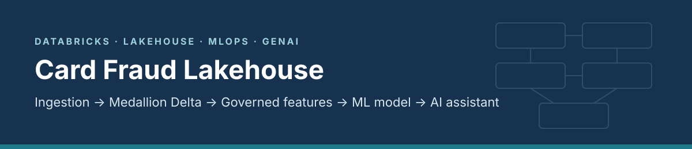
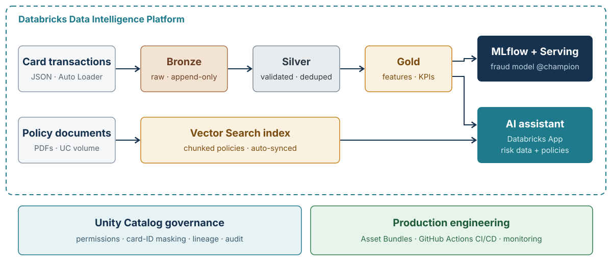

<p align="center">
  
</p>

<p align="center">
  
  
  
  
  
</p>

<p align="center">
  <b>End-to-end fraud detection on the Databricks Data Intelligence Platform</b><br>
  Built by <a href="https://www.linkedin.com/in/shridhar-c-14aa3b11">Shridhar Ch</a> · banking risk &amp; fraud analytics → data &amp; AI engineering
</p>

---

## Contents

[Business problem](#-business-problem) · [Architecture](#-architecture) · [What's inside](#-whats-inside) · [Quick start](#-quick-start) · [Results](#-results) · [Design decisions](#-design-decisions) · [Roadmap](#-roadmap)

> **Data notice:** all data is **synthetic**, generated by [`src/fraud_lib/synthetic_data.py`](src/fraud_lib/synthetic_data.py). No real customer or employer data is used.

## 🎯 Business problem

Card issuers lose money to fraud, and they lose good customers when genuine transactions are declined.

| Goal | How it is measured |
| :--- | :--- |
| Catch more fraud | Fraud caught per 1,000 alerts |
| Annoy fewer good customers | False-positive rate |
| Satisfy auditors and regulators | Every decision explainable and traceable to its data |

## 🏗 Architecture

<p align="center">
  
</p>

## 📦 What's inside

| Stage | Implementation | Code |
| :--- | :--- | :--- |
| **1 · Data** | Synthetic transactions with fraud bursts, a skewed "hot" merchant and injected bad records | [`synthetic_data.py`](src/fraud_lib/synthetic_data.py) · [`01_generate`](notebooks/01_generate_synthetic_data.py) |
| **2 · Ingestion + medallion** | Lakeflow Declarative Pipeline · Auto Loader · data-quality expectations | [`fraud_pipeline.py`](src/pipeline/fraud_pipeline.py) |
| **3 · Governance** | Unity Catalog schemas, volume, card-ID column mask, lineage | [`00_setup`](notebooks/00_setup_catalog.sql) · [`02_mask`](notebooks/02_governance_column_mask.sql) |
| **4 · Performance** | Reproduce data skew; fix with AQE and key salting | [`03_skew_demo`](notebooks/03_skew_demo.py) |
| **5 · ML** | Gradient-boosted model · MLflow tracking · Unity Catalog registry · `@champion` alias | [`04_train`](notebooks/04_train_fraud_model.py) |
| **6 · Deployment** | Databricks Asset Bundle · GitHub Actions (tests → validate → deploy) | [`databricks.yml`](databricks.yml) · [`ci-cd.yml`](.github/workflows/ci-cd.yml) |
| **7 · AI assistant** | Vector Search over policy documents + Databricks App | *in progress* |

## 🚀 Quick start

<details open>
<summary><b>Run on Databricks Free Edition</b></summary>

1. Create a workspace at Databricks Free Edition.
2. **Workspace → Create → Git folder** → paste this repository URL.
3. Run `notebooks/00_setup_catalog.sql`.
4. Run `notebooks/01_generate_synthetic_data.py`.
5. Create a pipeline from `src/pipeline/fraud_pipeline.py` (catalog `fraud`, schema `silver`) and start it.
6. Run notebooks `02`, `03` and `04` in order.

</details>

<details>
<summary><b>Deploy with the Databricks CLI</b></summary>

```bash
databricks bundle validate -t dev
databricks bundle deploy -t dev
databricks bundle run fraud_pipeline -t dev
```
</details>

<details>
<summary><b>Run the unit tests locally</b></summary>

```bash
pip install -r requirements-dev.txt
pytest -q
```
</details>

## 📊 Results

Measured outcomes from my own runs are in **[docs/RESULTS.md](docs/RESULTS.md)**, with workspace screenshots in **[docs/screenshots](docs/screenshots)**.

## 🧭 Design decisions

| Decision | Why |
| :--- | :--- |
| **Medallion layers** | Bronze stays replayable; quality is enforced once in Silver; consumers read Gold |
| **Drop vs warn expectations** | Bad amounts and missing cards are dropped; currency mismatches only warn, so nothing is silently lost |
| **Average precision as the main metric** | Fraud is rare, so accuracy looks high even for a useless model |
| **Rules decide, model scores, AI explains** | Lending and fraud decisions must stay explainable and auditable |
| **Roles, not keys** | Access through Unity Catalog and cloud roles; no credentials in code |

## 🗺 Roadmap

- [x] Synthetic data generator with unit tests
- [ ] Medallion pipeline run on Databricks, data-quality results recorded
- [ ] Governance, skew-fix and model-training runs recorded in RESULTS.md
- [ ] Model Serving endpoint with the `@champion` alias
- [ ] Lakehouse Monitoring for drift
- [ ] AI assistant: Vector Search over policies + Databricks App
- [ ] Streaming ingestion from a message queue

---

<p align="center">
  <sub>Shridhar Ch · Bengaluru · <a href="https://www.linkedin.com/in/shridhar-c-14aa3b11">LinkedIn</a></sub>
</p>
