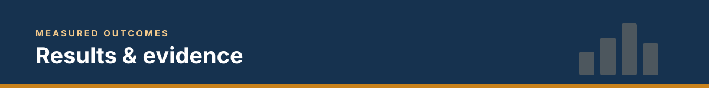

  

  <a href="../README.md"><b>← Back to project</b></a> ·
  <a href="screenshots/README.md"><b>Screenshot gallery</b></a>

> [!NOTE]
> Every number on this page comes from my own runs on Databricks Free Edition with synthetic data.
> Sections marked ⏳ are filled in as each milestone is completed.

**Run date:** `YYYY-MM-DD` &nbsp;·&nbsp; **Workspace:** Databricks Free Edition (serverless)

---

## 1 · Data generated &nbsp; ⏳

| Metric | Value |
| :--- | ---: |
| Batches / rows written | |
| Labelled fraud rows (share) | |
| Share of rows on hot merchant `M00001` | |

## 2 · Pipeline data quality &nbsp; ⏳

| Expectation | Records failed | Action |
| :--- | ---: | :-: |
| `positive_amount` | | 🗑 dropped |
| `card_present` | | 🗑 dropped |
| `known_currency` | | ⚠️ warned |
| Duplicates removed | | 🗑 dropped |

**Row flow:** Bronze `___` → Silver `___` → Gold features `___`

## 3 · Skew fix &nbsp; ⏳

| Run | Duration | Longest task vs median |
| :--- | ---: | ---: |
| Before | | |
| Fix A · AQE | | |
| Fix B · salting | | |

**What I observed:** _one or two sentences in my own words_

## 4 · Fraud model &nbsp; ⏳

| Metric | Value |
| :--- | ---: |
| Average precision | |
| Precision @ 0.5 | |
| Recall @ 0.5 | |
| Registered version | `fraud.ml.card_fraud_model` v__ `@champion` |

**What I would improve next:** _my own words_

## 5 · Problems I hit and how I fixed them

| Problem | Root cause | Fix |
| :--- | :--- | :--- |
| | | |

---

Shridhar Ch · <a href="https://www.linkedin.com/in/shridhar-c-14aa3b11">LinkedIn</a>

